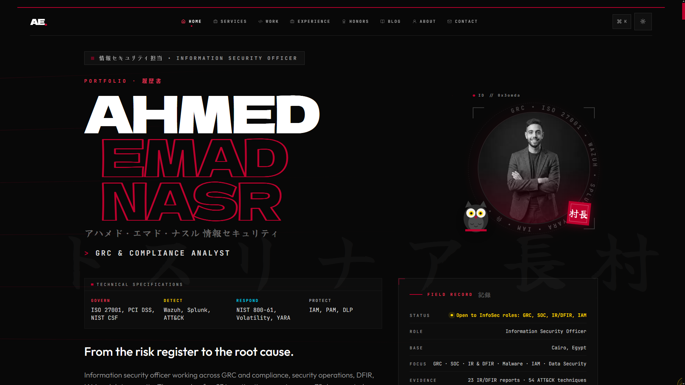
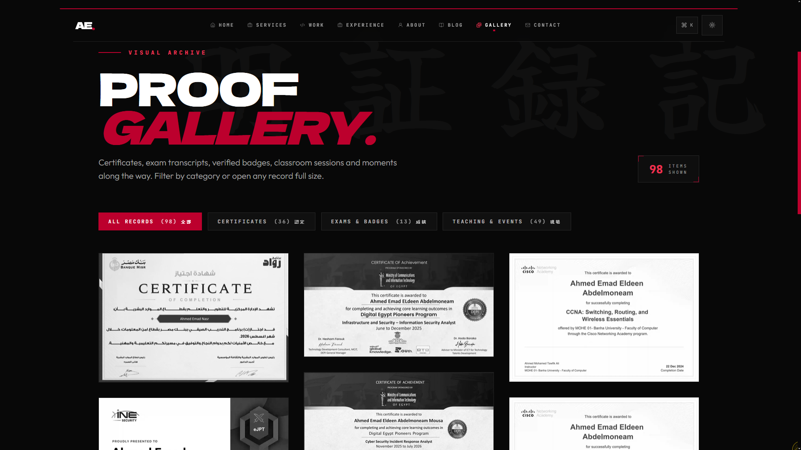

<div align="center">

# AHMED EMAD NASR

### Information Security Portfolio

`GRC` · `SOC` · `IR/DFIR` · `Malware Analysis` · `IAM` · `Data Security`

<a href="https://ahmed-emad-nasr.github.io/Portfolio/">
  
</a>
<a href="https://github.com/Ahmed-Emad-Nasr">
  
</a>
<a href="mailto:ahmed.em.nasr@gmail.com">
  
</a>

<br>
<br>

> **FIELD NOTE:** A security-focused portfolio for turning risk registers,
> alerts, and forensic evidence into clear decisions and actionable outcomes.

</div>

---

## `01 // SYSTEM OVERVIEW`

This repository contains my personal information security portfolio. It is
designed as a case library rather than a static resume: each project connects
the finding, evidence, analysis, response, and lessons learned.

The portfolio covers:

- Governance, risk, compliance, and ISO 27001 / PCI DSS / NIST CSF thinking
- SOC alert triage, Wazuh, Splunk, detection engineering, and ATT&CK mapping
- Incident response, digital forensics, malware analysis, and chain of custody
- IAM, PAM, DLP, cloud security, data security, and security assessments
- Practical web security labs, attack simulations, and technical write-ups

**Live system:** <https://ahmed-emad-nasr.github.io/Portfolio/>

---

## `02 // VISUAL TELEMETRY`

### Portfolio interface

<p align="center">
  
</p>

### Gallery loading sequence

<p align="center">
  
</p>

### Operator signal feed

<p align="center">
  
  &nbsp;&nbsp;&nbsp;
  
</p>

---

## `03 // CAPABILITIES`

| Domain        | Focus                                                           |
| ------------- | --------------------------------------------------------------- |
| `GOVERN`      | GRC, ISO 27001, PCI DSS, NIST CSF, risk and compliance          |
| `DETECT`      | Wazuh, Splunk, ATT&CK, custom rules, alert triage               |
| `RESPOND`     | NIST 800-61, Volatility, YARA, incident reporting               |
| `INVESTIGATE` | DFIR, malware analysis, email analysis, timeline reconstruction |
| `PROTECT`     | IAM, PAM, DLP, cloud security, data security                    |
| `ASSESS`      | Web security testing, threat intelligence, attack simulation    |

The site includes a searchable case library, evidence screenshots, detection
rules, ATT&CK coverage, videos, a proof gallery, and a printable CV.

---

## `04 // STACK`

```text
Next.js 16       App Router + static export
React 19         TypeScript
Tailwind CSS v4  Framer Motion + GSAP
Lenis            next-themes
Lucide React     Yet Another React Lightbox
```

The application is exported as a static site and deployed to GitHub Pages.
Non-critical sections use dynamic imports, lazy sections, and deferred global
effects to keep the initial route focused on the critical content.

See [ARCHITECTURE.md](./ARCHITECTURE.md) for route boundaries, loading rules,
code splitting, and asset ownership.

---

## `05 // QUICK START`

```bash
git clone https://github.com/Ahmed-Emad-Nasr/Portfolio.git
cd Portfolio
npm install
npm run dev
```

Open <http://localhost:3000>.

### Production checks

```bash
npm run lint
npm run type-check
npm run check:data
npm run check:assets
npm run build
npm run check:links
npm run check:a11y
```

The complete verification command is:

```bash
npm run verify
```

The build output is written to `out/`. Deployment runs from `master` through
`.github/workflows/nextjs.yml`.

---

## `06 // PROJECT MAP`

```text
app/          routes, metadata, feeds, sitemap, JSON endpoints
components/
  layout/     navigation, theme, terminal, shortcuts, global effects
  ui/         shared UI primitives and page shell
  home/       home sections and dynamic imports
  blog/       case library, filters, and case pages
  gallery/    proof gallery and lightbox
data/         portfolio content as typed TypeScript
lib/          routes, SEO, scrolling, parsing, and performance helpers
scripts/      audits, asset generation, and build checks
public/       images, reports, icons, and service worker
screenshots/  README visual previews
gif/          README animated visuals
```

### Content workflow

Site content lives in `data/`; it is not duplicated across page components.
To add a case:

1. Add the case record to [`data/cases.ts`](./data/cases.ts).
2. Add evidence screenshots to the matching asset directory.
3. Add optional case details and ATT&CK mappings.
4. Run `npm run thumbs` and `npm run og:cases`.
5. Run `npm run check:data` and `npm run check:assets`.

---

## `07 // ROUTES`

- `/` — portfolio home, services, experience, projects, and contact
- `/blog` — case library, videos, ATT&CK coverage, detections, and triage
- `/blog/<case-id>` — detailed case report
- `/gallery` — certificates, events, classroom, and security journey
- `/collections/web-security-academy` — PortSwigger learning track
- `/cv` — printable HTML CV
- `/privacy` and `/terms` — legal pages
- `/feed.xml`, `/sitemap.xml`, `/llms.txt` — machine-readable resources

Hidden operator tools include `Ctrl/⌘ K` for the command palette, `?` for
keyboard shortcuts, and the `3omda` terminal easter egg.

---

## `08 // CONFIGURATION`

Copy `.env.example` to `.env.local` when local configuration is needed:

- `NEXT_PUBLIC_WEB3FORMS_KEY` for the contact form

Without a Web3Forms key, the contact form opens the visitor's mail app.

---

## `09 // ATTRIBUTION`

The Neo-Samurai design language and component structure are based on
[Sensei-Dev](https://github.com/MostafaSensei106/Sensei-Dev) by Mostafa
Mahmoud, licensed under GPL-3.0. Portfolio content is original.

## `10 // LICENSE`

This repository is licensed under [GPL-3.0](./LICENSE). Fonts are provided under
the SIL Open Font License 1.1.

<div align="center">

`SECURITY IS A PROCESS. EVIDENCE MAKES IT REPEATABLE.`

</div>
